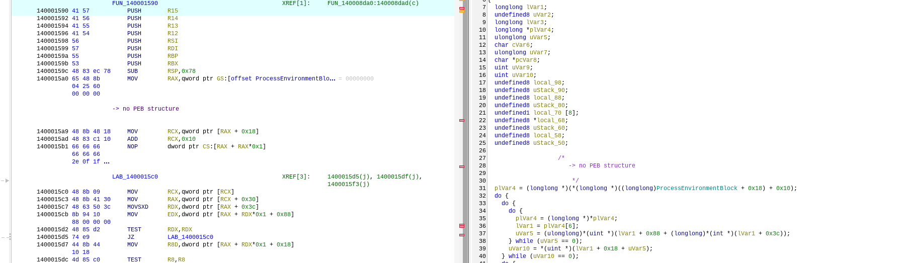
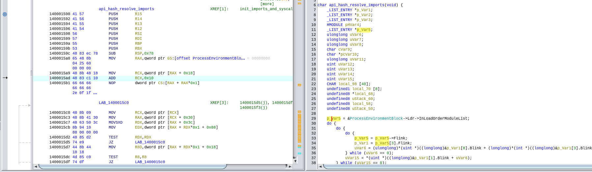

# GDT Generator for Ghidra

This is a semi-polished copy of my scripts to generate Ghidra data type archives (`.gdt`) for Windows
reverse or to download Microsoft PDB symbols. I added the archives that include PEB, TEB, loader, 
process-parameter, heap, and kernel structures. Include for example the GDT for `ntoskrnl` to get better
type information for PEB. The scripts query Winbindex and download PDBs from Microsoft. Because
the scripts are merged, this also includes a very minimal Winbindex client, but other projects 
are probably more advanced and better suited for that.

## Download GDT files

Choose the architecture of the program you are analyzing and the format matching
your Ghidra installation from the [Windows 10 22H2 collection](windows_10_22h2/):

| Windows module | Architecture | Ghidra 12.0.4 PUBLIC | Ghidra 12.1.4 PUBLIC | Ghidra 12.3 DEV |
| --- | --- | --- | --- | --- |
| `ntdll.dll` | x64 | [Download GDT](windows_10_22h2/x64/windows_10_22h2_ntdll_dll_x64_ghidra_12.0.4.gdt) | [Download GDT](windows_10_22h2/x64/windows_10_22h2_ntdll_dll_x64_ghidra_12.1.4.gdt) | [Download GDT](windows_10_22h2/x64/windows_10_22h2_ntdll_dll_x64_ghidra_12.3.gdt) |
| `ntdll.dll` | x86 / WOW64 | [Download GDT](windows_10_22h2/x86/windows_10_22h2_ntdll_dll_x86_ghidra_12.0.4.gdt) | [Download GDT](windows_10_22h2/x86/windows_10_22h2_ntdll_dll_x86_ghidra_12.1.4.gdt) | [Download GDT](windows_10_22h2/x86/windows_10_22h2_ntdll_dll_x86_ghidra_12.3.gdt) |
| `ntoskrnl.exe` | x64 | [Download GDT](windows_10_22h2/x64/windows_10_22h2_ntoskrnl_exe_x64_ghidra_12.0.4.gdt) | [Download GDT](windows_10_22h2/x64/windows_10_22h2_ntoskrnl_exe_x64_ghidra_12.1.4.gdt) | [Download GDT](windows_10_22h2/x64/windows_10_22h2_ntoskrnl_exe_x64_ghidra_12.3.gdt) |
| `win32k.sys` | x64 | [Download GDT](windows_10_22h2/x64/windows_10_22h2_win32k_sys_x64_ghidra_12.0.4.gdt) | [Download GDT](windows_10_22h2/x64/windows_10_22h2_win32k_sys_x64_ghidra_12.1.4.gdt) | [Download GDT](windows_10_22h2/x64/windows_10_22h2_win32k_sys_x64_ghidra_12.3.gdt) |

**Ghidra 12.0.4 cannot open archives created with 12.3 DEV.** Use the matching
files or [generate a set](#build-or-download-symbols) with your installed Ghidra.
See [Using the archives](#using-the-archives) for import instructions and
[sources.json](windows_10_22h2/sources.json) for exact binary versions, PDB
identities, source hashes, and historical verification records. Windows binaries
and PDBs are not bundled in this repository.

## Using the archives

The bundled collection comes from Windows 10 22H2 English x64, Windows 10 Home.
The `_ghidra_12.0.4.gdt` files use 12.0.4 PUBLIC; `_ghidra_12.1.4.gdt` files were
exported directly from the PDBs with 12.1.4 PUBLIC. The `_ghidra_12.3.gdt` copies
were upgraded for 12.3 DEV. See [sources.json](windows_10_22h2/sources.json) for
source media, binary versions, build provenance, and verification details.

In Ghidra's **Data Type Manager**, choose **Open File Archive...** and select the
matching architecture and format. Use x86 ntdll for 32-bit programs (including
WOW64), or x64 ntdll for 64-bit programs, then apply types such as `_PEB *`.
Opening an archive makes types available; it does not assign them automatically.

## PEB example: before and after applying types

These screenshots show the same x64 code using types from the **`ntoskrnl.exe`
GDT archive**. [Open the archive](#using-the-archives) in Data Type Manager and
apply `_PEB *` to the pointer holding the Process Environment Block address.

**Without PEB types**, Ghidra shows the access through `GS:[0x60]`, but the
decompiler expresses subsequent field accesses as casts and pointer arithmetic:
`+ 0x18` followed by `+ 0x10`. The structure of the loader's module list is hidden.



**With the archives types applied**, the same access becomes
`&ProcessEnvironmentBlock->Ldr->InLoadOrderModuleList`. Variables gain types such
as `_LIST_ENTRY *`, and list traversal uses named fields such as `Flink`. For this
x64 layout, `0x18` selects `_PEB.Ldr` and `0x10` selects
`_PEB_LDR_DATA.InLoadOrderModuleList`. The same applies to other type information.



The kernel archive gets these definitions from the matching **`ntkrnlmp.pdb`**
downloaded from the Microsoft symbol server. That PDB contains `_PEB`,
`_PEB_LDR_DATA`, and related type records, the kernel struct `_EPROCESS` also has a
`Peb` pointer. Exporting those records preserves member names, offsets, and
types, including internal fields such as `ProcessHeap` and `NtGlobalFlag`.
The PEB is partly documented, but the public SDK exposes a reduced definition
with many reserved fields, see Microsoft's [PEB documentation](https://learn.microsoft.com/en-us/windows/win32/api/winternl/ns-winternl-peb).

The PDB supplies a fuller layout for its particular Windows build, making those
otherwise undocumented fields usable during analysis. Match the archive to the
target architecture and Windows build, since internal layouts can change.

## Build or download symbols

Execution supports Linux and Windows x86/x64 inputs and uses headless
Ghidra.

- Python 3.11 or newer
- GDT generation also needs a built Ghidra installation, its compatible JDK
  (`java` and `javac` on `PATH`), and `llvm-pdbutil`.
- Uncached online inputs need access to Winbindex and Microsoft's symbol server.
  Listing builds and `--download-only` need neither Ghidra nor LLVM.

There are no third-party Python packages to install. Ghidra, a compatible JDK,
and LLVM are installed separately; missing tools do not prevent download-only
use. Rerunning setup preserves the environment's contents. Activation must be
run in your current shell; use `deactivate` when finished.

Pass your **Ghidra installation root** to `--ghidra`: the extracted folder
containing `ghidraRun`, `Ghidra/`, and `support/analyzeHeadless`. Any installation
path is supported, including custom builds; quote paths containing spaces.

### List builds and choose a file

Winbindex lists builds of individual files and their associated Windows releases:

```sh
python3 build.py --winbindex ntdll.dll --list-builds
python3 build.py --winbindex ntdll.dll --arch x64 --list-builds
```

Replace `ntdll.dll` with another filename, such as `ntoskrnl.exe`, or use
`--arch x86` for 32-bit builds. Listing downloads only metadata. Its columns are
the numeric `FILE VERSION`, `ARCH`, `WINDOWS RELEASES` (`-` if unknown), and
binary `SHA-256`. It lists builds of the selected file, not all Windows editions.
Copy the numeric file version (for example, `10.0.26100.1`), not a release label
such as `22H2`, into `--file-version`.

### Get a DLL/EXE and its PDB

Select a version and architecture to retain both the binary and matching symbols:

```sh
python3 build.py --winbindex ntdll.dll --arch x64 \
  --file-version 10.0.26100.1 --download-only

# Select an exact binary hash if version/architecture is ambiguous.
python3 build.py --winbindex ntdll.dll \
  --sha256 473a02e37fd071620029c844ed3df71646b18208d8806e33e00ddd72e908534f \
  --download-only
```

For an EXE, use a filename such as `ntoskrnl.exe` and a version from its listing.
Ambiguous selections report candidate hashes. Binary URLs follow the Winbindex
[upstream implementation](https://github.com/m417z/winbindex/blob/main/winbindex.js);
downloaded bytes must match the selected SHA-256. A server returning a different
binary is an error; choose another build, a local binary, or a known-PDB manifest.

### Get symbols for local binaries

Read the matching PDB identity from a DLL or EXE; repeat `--binary` for a set:

```sh
python3 build.py --binary /path/to/ntdll.dll --download-only
python3 build.py --binary /path/to/ntdll.dll \
  --binary /path/to/ntoskrnl.exe --download-only
```

The pipeline retains a verified copy of each binary and its PDB. Each run prints
`Provenance: sources/<set-id>/sources.json`; the manifest's `modules` entries give
the exact retained paths in `binary_path` and `pdb.path`. Copy those files from
the cache if you need them elsewhere.

### Generate GDTs or reuse a manifest

Supply Ghidra to generate verified archives from any supported source:

```sh
python3 build.py --winbindex ntdll.dll --arch x64 \
  --file-version 10.0.26100.1 --ghidra /path/to/ghidra_12.0.4_PUBLIC
python3 build.py --manifest windows_10_22h2/sources.json \
  --ghidra /path/to/ghidra_12.1.4_PUBLIC

# Rebuild a previous download without network access. Replace SET_ID first.
python3 build.py --manifest sources/SET_ID/sources.json \
  --offline --ghidra /path/to/ghidra_12.3_DEV
```

The command prints `Verified archives:` with the completed folder. A manifest
with known PDB identities needs no original binary. `--offline` uses local files
and verified cache entries and fails if an input is missing or corrupt. Retain
the cache and manifests to rebuild offline with your installed tools.

## Storage and Ghidra compatibility

Storage is relative to the directory where you run the command. GDTs are grouped
by the Ghidra version/build that created them; binaries and PDBs are shared.

| Location | Contents and lifetime |
| --- | --- |
| `.cache/ghidra-gdt/binaries/<sha256>/<filename>` | Retained, verified DLLs and EXEs. |
| `.cache/ghidra-gdt/symbols/<filename>/<GUID-and-age>/<filename>` | Retained, verified PDBs. |
| `.cache/ghidra-gdt/winbindex/` | Retained metadata snapshots for offline selection. |
| `sources/<set-id>/sources.json` | Reusable selection, versions, identities, hashes, paths, and per-module failures. Prior records stay in `history/`. |
| `archives/<ghidra-version-release>/<build-fingerprint>/<set-id>/` | Completed GDTs, `sources.json`, `SHA256SUMS`, and `verification.json`; never overwritten. |
| `.cache/ghidra-gdt/runs/` | Temporary LLVM dumps, layouts, Ghidra caches, and logs. Removed after successful publication; failed/interrupted builds retain diagnostics. |

Workspace cleanup is best effort: a removal failure does not invalidate a
completed archive. Binaries, PDBs, manifests, completed archives, and original
media persist. Obsolete ISO extraction data is not needed by this pipeline.

PDB keys follow Microsoft's
[symbol-store identities](https://learn.microsoft.com/en-us/windows/win32/debug/using-symstore).
Downloads use temporary files, up to three attempts, identity/hash checks, and
atomic completion. Reused PDBs are checked again. Failures return a nonzero status
while preserving successful downloads and recording failures in the manifest.
Recorded identities and hashes allow manifest reuse with another cache.

The same selection generated with three Ghidra installations is stored separately:

```text
archives/
├── 12.0.4-PUBLIC/<build-fingerprint>/<set-id>/
├── 12.1.4-PUBLIC/<build-fingerprint>/<set-id>/
└── 12.3-DEV/<build-fingerprint>/<set-id>/
```

Each completed folder contains provenance, checksums, validation results, and
`x64/` or `x86/` directories for architectures with exported types. The fingerprint
hashes installation metadata, JARs, and language definitions; modified builds
with the same version get distinct folders. The set ID identifies the normalized
module selection. Windows binary versions are recorded in `sources.json`.

Open a GDT with the producing Ghidra build or a newer compatible version. Upgrade
a copy if required. Older versions may reject newer archives, as 12.0.4 does with
the tested 12.3 DEV format. DEV/custom version labels alone do not guarantee
compatibility; regenerate from the manifest with your intended installation.
To regenerate an already completed set with identical inputs and installation,
run from another working directory. GDTs and provenance can be tracked in Git;
the cache, temporary artifacts, and all case variants of `.pdb` are ignored.

## Tests

```sh
python3 -m unittest discover -s tests -v

GDT_TEST_GHIDRA=/path/ghidra_12.0.4_PUBLIC:/path/ghidra_12.1.4_PUBLIC:/path/ghidra_12.3_DEV \
GDT_TEST_NETWORK=1 \
python3 -m unittest discover -s tests -p test_integration.py -v
```

`GDT_TEST_CACHE` optionally selects a shared integration cache for test archives and
audit diagnostics, default is `.cache` path in this repo. 